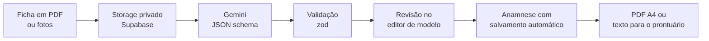

# Prontus

**Anamnese padronizada com IA.** App web para profissionais e estudantes de medicina transformarem a ficha de anamnese que já usam (PDF ou foto) em um modelo digital, preencherem anamneses a partir dele e exportarem tudo no formato clínico padrão.

**App em produção:** https://prontus-med.vercel.app · **Código:** https://github.com/fabianocd/prontus

[](https://github.com/fabianocd/prontus/actions/workflows/ci.yml)


## O problema

Cada serviço e cada disciplina usam uma ficha de anamnese diferente, quase sempre em papel ou PDF. Passar isso para o prontuário é demorado, e o texto final sai sem padrão. O Prontus lê a ficha, monta um formulário com os mesmos campos e gera o texto já formatado:

```
#ID: M.S., 2 ANOS, NATURAL DE SOBRAL-CE, ACOMPANHADA PELA MÃE
#QP: FEBRE HÁ 3 DIAS
#HDA: ...
#ALIMENTAÇÃO:
-ALEITAMENTO MATERNO EXCLUSIVO: ATÉ 6 MESES
-INTRODUÇÃO ALIMENTAR: ...
#CONDUTA: ...
```

## Como funciona



1. **Novo modelo:** a pessoa envia 1 PDF ou até 10 fotos da ficha (até 20 MB).
2. **Extração com IA:** o Gemini devolve as seções e os campos em JSON estruturado. Ele extrai só o que é campo a preencher e ignora anexos (escalas, calendário vacinal, tabelas de percentis, cabeçalhos institucionais).
3. **Revisão:** a IA só gera um rascunho. A pessoa ajusta títulos, siglas, tipos de campo e a ordem antes de salvar.
4. **Preenchimento:** um formulário é gerado a partir do modelo, com salvamento automático e progresso por seção.
5. **Exportação:** prévia em formato de folha, PDF A4 e "Copiar texto" para colar no prontuário.

## Funcionalidades

- **Editor de modelo:** seções com sigla (ID, QP, HDA, HPP, HF...), campos de texto, texto longo, número, data, lista e Sim/Não, arrastar e soltar e prévia ao vivo. Cada especialidade pode ter um modelo padrão.
- **Histórico:** busca por título ou paciente, filtro por modelo, duplicar e excluir.
- **Calendário:** atendimentos com horário, local e repetição semanal. Ao clicar num dia, aparecem os atendimentos e as anamneses daquele dia.
- **Bloco de Notas:** notas livres com salvamento automático.
- **Conta:** cadastro com confirmação por e-mail, recuperação de senha, perfil, tema claro ou escuro e exclusão da conta com todos os dados.
- **Responsivo:** funciona no celular, onde a anamnese costuma ser feita.

## Destaques técnicos

- **Saída estruturada e validada:** o Gemini responde seguindo um JSON schema, e o resultado passa por zod e por uma etapa de normalização antes de chegar à interface. Se a extração falhar, a pessoa recebe uma mensagem clara e pode montar o modelo manualmente.
- **Resiliência na chamada à IA:** quando o modelo principal está sobrecarregado (503) ou demora demais, o servidor tenta modelos alternativos em sequência, dentro de um limite de tempo compatível com a função serverless. Arquivos grandes vão pela Files API em vez de inline.
- **Snapshot do modelo:** cada anamnese guarda uma cópia do modelo usado. Editar o modelo depois não altera as anamneses antigas. Quando o modelo muda, a anamnese oferece "Atualizar esta anamnese" sem perder respostas.
- **Isolamento de dados no banco:** RLS em todas as tabelas (`auth.uid() = user_id`) e chaves estrangeiras compostas `(id, user_id)`. Nem uma requisição forjada consegue ligar dados a registros de outra conta.
- **Arquivos privados:** bucket sem acesso público, policies por pasta do usuário (`{user_id}/...`) e leitura por signed URLs.
- **Chaves só no servidor:** a chave do Gemini e a chave secreta do Supabase nunca chegam ao navegador (módulos marcados com `server-only`).
- **LGPD:** o paciente é identificado só por iniciais ou código. O app não coleta CPF, endereço nem nome completo, e a IA recebe apenas a ficha em branco.
- **Next.js 16 moderno:** App Router com `cacheComponents`, Server Components por padrão, Server Actions validadas com zod e `proxy.ts` para renovar a sessão e proteger as rotas.

## Stack

| Área | Tecnologia |
| --- | --- |
| Framework | Next.js 16 (App Router), React 19, TypeScript strict |
| Interface | Tailwind CSS 4, shadcn/ui, dnd-kit, sonner |
| Formulários e validação | zod |
| Backend | Supabase: Auth, Postgres com RLS, Storage (`@supabase/ssr`) |
| IA | Gemini API (`@google/genai`), saída estruturada em JSON schema |
| PDF | `@react-pdf/renderer`, gerado no navegador, fonte Inter |
| Deploy | Vercel, com publicação automática a cada push na `main` |

## Estrutura

```
src/
  app/
    (auth)/            entrar, cadastro, recuperar e redefinir senha
    (app)/             modelos, anamneses, histórico, calendário, notas, configurações
    api/modelos/       rota de extração com o Gemini
    auth/confirm/      destino dos links de e-mail
  components/
    template-editor/   editor de modelo
    anamnesis-form/    formulário de preenchimento
    anamnesis-export/  prévia e PDF
    app-shell/         sidebar e barra do celular
    ui/                componentes shadcn/ui
  lib/
    gemini/            chamada à IA e normalização do resultado
    templates/         schema do modelo (zod) e preparação para salvar
    anamneses/         respostas, formatador de exportação e atualização com o modelo
    calendar/          datas no fuso de Brasília e validação dos atendimentos
    supabase/          clientes (navegador, servidor, proxy) e tipos gerados
  proxy.ts             renova a sessão e protege as rotas
supabase/migrations/   migrations do banco (schema, RLS e policies de storage)
docs/PLANO.md          plano por fases e decisões tomadas
```

## Como rodar localmente

Pré-requisitos: Node.js 20+, um projeto no [Supabase](https://supabase.com) e uma chave da [Gemini API](https://aistudio.google.com/apikey).

1. No Supabase, crie um bucket **privado** chamado `anamneses-docs` e aplique as migrations de `supabase/migrations/`, em ordem.
2. Em Authentication > URL Configuration, adicione `http://localhost:3010/**` às Redirect URLs.
3. Rode:

```bash
npm install
cp .env.example .env.local   # preencha as variáveis abaixo
npm run dev                  # http://localhost:3010
```

### Variáveis de ambiente

| Variável | Onde é usada | Descrição |
| --- | --- | --- |
| `NEXT_PUBLIC_SUPABASE_URL` | cliente e servidor | URL do projeto Supabase |
| `NEXT_PUBLIC_SUPABASE_ANON_KEY` | cliente e servidor | Chave publicável (`sb_publishable_...`) |
| `SUPABASE_SECRET_KEY` | só servidor | Chave secreta, usada apenas para excluir a conta |
| `GEMINI_API_KEY` | só servidor | Chave da Gemini API |
| `GEMINI_MODEL` | só servidor (opcional) | Troca o modelo principal (padrão: `gemini-3.8-flash`) |

### Scripts

| Comando | O que faz |
| --- | --- |
| `npm run dev` | Servidor de desenvolvimento na porta 3010 |
| `npm run build` | Build de produção |
| `npm run typecheck` | Gera os tipos de rota e roda `tsc` |
| `npm run lint` | ESLint |

Depois de cada migration nova, regenere `src/lib/supabase/database.types.ts`.

## Deploy

O projeto está na Vercel, ligado a este repositório, e cada push na `main` vai para produção. As funções rodam em `iad1`, perto do banco (`us-east-2`). As mesmas variáveis de ambiente ficam configuradas na Vercel.

No Supabase, a Site URL aponta para o domínio de produção, as Redirect URLs incluem esse domínio e `http://localhost:3010/**`, e a confirmação de e-mail está ligada.

## Sobre o desenvolvimento

Projeto desenvolvido com apoio do Claude Code como agente de programação. A especificação do produto, as decisões de arquitetura e segurança e as convenções do código estão em [`CLAUDE.md`](CLAUDE.md), e o plano por fases está em [`docs/PLANO.md`](docs/PLANO.md).

Para testar a extração, use uma ficha de anamnese em branco, sem dados de pacientes.
